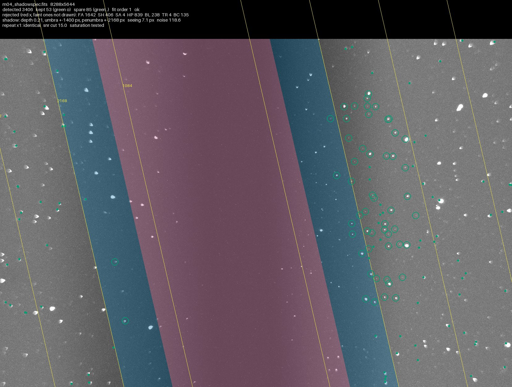
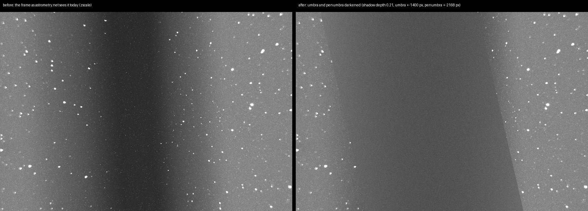
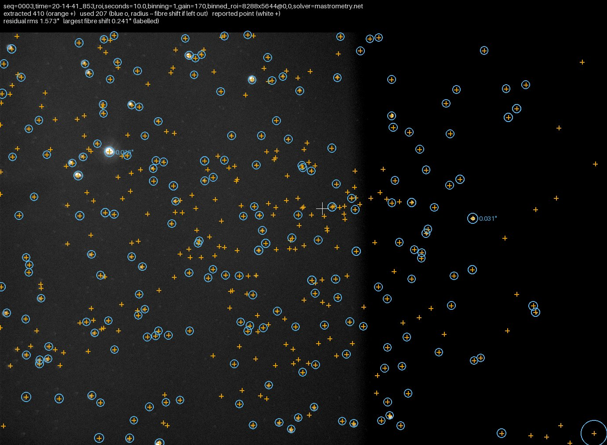
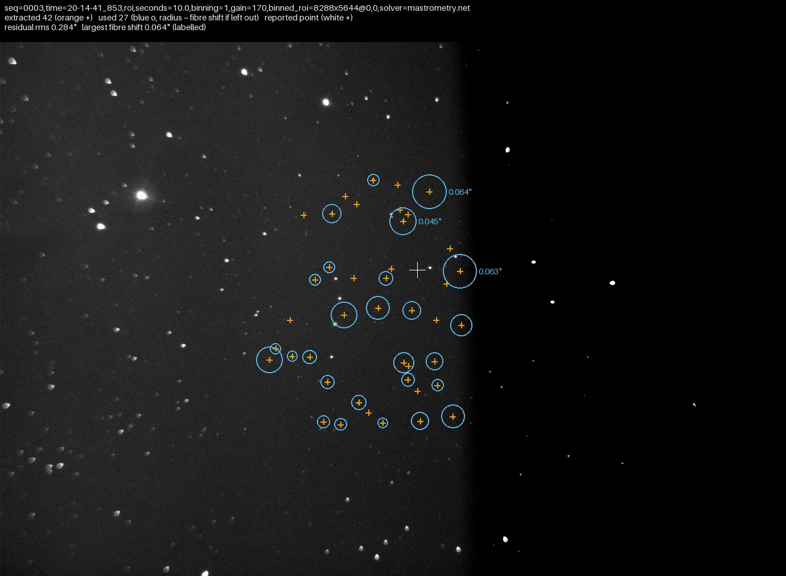
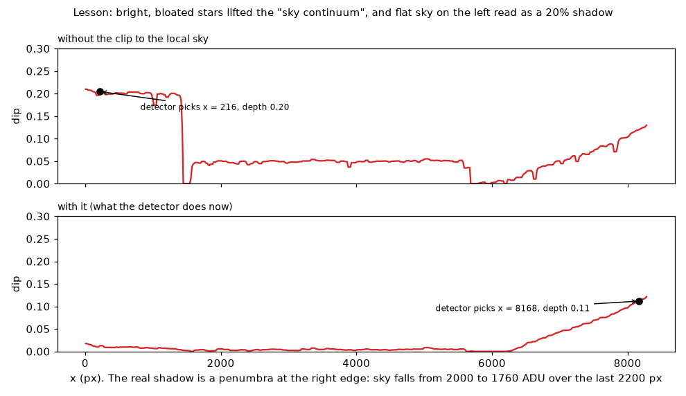
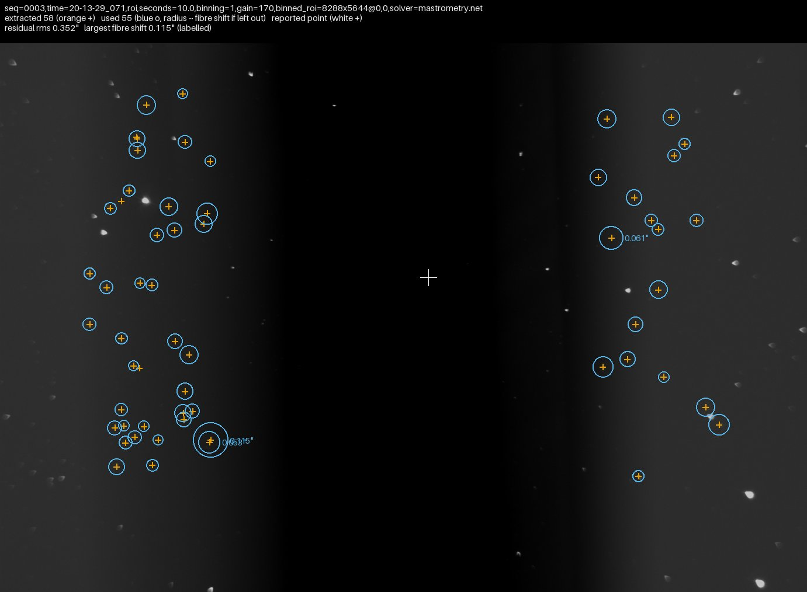
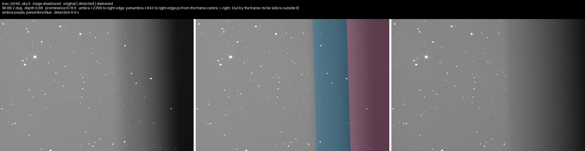

# Mastrometry stages: plate solving that knows about the fold-mirror shadow

*Status, 2026-11-20: working and measured on 37 real frames from two units (mast01 and mast02), **pushed, not merged,
off by default**. MAST_unit branch `solver-source-selection` (on top of PR #409), MAST_common branch
`solving-source-selection-config`. Every number below comes from real MAST frames, full frame, solved on mast08. What we
have not done yet, and what the numbers cannot tell us, is in [section 8](#8-what-we-do-not-know-yet).*

## 1. Summary

`MastrometryDotNet` solves a frame with astrometry.net and reports the sky position at the fibre. We added two things
in front of astrometry.net and made them switchable, as three **stages**:

| Stage | What astrometry.net is given |
|---|---|
| **original** | the frame as it always was (the default) |
| **shadowed** | the same frame, with the fold mirror's shadow detected and its band darkened |
| **selective** | a list of about 40 chosen stars, outside the shadow and away from trouble, solved as an xylist |

On 37 real frames (mast01: 6; mast02: 31, from production acquisitions and a mirror-map sweep), measured as the median
distance of the matched stars from their catalogue positions, after the solve (the median over frames of each frame's
median):

| | original | shadowed | selective |
|---|---|---|---|
| frames solved | 36 of 37 | 36 of 37 | 36 of 37 |
| stars used by the fit (median) | 208 to 274 | 154 to 207 | 22 to 30 |
| median residual, mast01 (6 frames) | 0.63″ | 0.50″ | **0.25″** |
| median residual, mast02 (31 frames) | 0.48 to 0.52″ | 0.38 to 0.41″ | **0.11 to 0.17″** |
| time per frame, whole frame (median) | 5.7 s | 32.7 s | 28.3 s |

The one frame not solved is the same in all three stages (a 2 s exposure). The shadowed stage is better than the
original on every set (by 20 to 21%), and the selective stage is 2.5 to 4.7 times better. **That is the agreement of a
solution with its own stars, not its accuracy.** A first independent check, against Gaia on stars neither fit used
([section 7.7](#77-an-independent-check-against-gaia)), puts the selective stage 0.17″ from Gaia near the fibre on mast02 and the original
0.52″. The real test, a Gaia star on the fibre, is still to come ([section 8](#8-what-we-do-not-know-yet)). The time is spent in Python (shadow detection, then
darkening or star selection), not in astrometry.net; it is broken down in [section 7.3](#73-where-the-time-goes).

## 2. Motivation

**What mastrometry does today.** For the `sky` and `spec` phases the unit crops the frame to a region of interest,
bins it 2×2 (0.2616″ becomes 0.5232″ per pixel), and hands the image to astrometry.net, which extracts its own sources
(about 410 on a 10 s frame), matches them to the index and fits a WCS. The reference pixel (CRPIX) is the ROI's centre.
For the `spec` phase the guiding ROI is centred on the **fibre pixel**, so the solved RA and Dec are the sky at the
fibre; for the `sky` phase it is the sky ROI's centre. The acquisition corrects against that position.

**The problem: the fold mirror's shadow.** The pick-off mirror throws a shadow on the camera, and where it falls depends on where
the stage puts the mirror:

- with the mirror in (`spec`), a band about 4000 px wide across the middle of the frame, 50% deep;
- at the `sky` position, the mirror's edge is at a vertical edge of the frame: a partial band, up to 65% deep.

Stars in the shadow are dimmed, and astrometry.net uses them like any other. In the first frame we measured (a `spec`
frame), 38 of the 210 stars used were in the umbra and 41 in the penumbra, and the umbra stars had **twice the median
residual** of the whole (1.55″ against 0.79″). astrometry.net fits an order-2 distortion to all of them.

**The second problem: what we feed the solver.** The planned in-house guiding (correlating star positions, to disentangle
from PHD2) will need a reliable list of stars anyway: unsaturated, unblended, not in the shadow, centroided in a way
that does not depend on how bright or comatic a star is. MAST has no field corrector, so coma is at full strength, and
stars toward the periphery are wedge-shaped (a head and a tail), as the pictures below show. A list that is chosen,
rather than whatever astrometry.net extracts, is the first step toward that.

**What we wanted to learn:** does removing the shadow's influence (shadowed), and feeding the solver a curated list
(selective), give a steadier and more accurate pointing at the fibre than what we do today?

## 3. The three stages

The mode is `solving.source_selection.mode` in the unit's configuration (MAST_common `SourceSelectionConfig`). It
defaults to `original`, and nothing changes until a unit sets it.

```
original :  frame -> crop to ROI -> bin 2x2 -> solve-field on the image

shadowed :  frame -> crop to ROI -> [fill hot pixels] -> [detect the shadow] -> [darken its band]
                  -> bin 2x2 -> solve-field on the image

selective:  frame -> crop to ROI -> [fill hot pixels] -> [detect the shadow] -> [choose the stars]
                  -> write an xylist -> solve-field on the xylist (order 1)
                                          '-- if that fails: bin 2x2 -> solve-field on the image

[ ] = added by this work
```

| | original | shadowed | selective |
|---|---|---|---|
| hot pixels filled (if mapped) | no | yes | yes |
| shadow detected | no | yes | yes |
| shadow darkened | no | yes (umbra and penumbra) | no: it only rejects sources |
| who picks the stars | astrometry.net's `image2xy` | the same, on the darkened image | our `select_sources` |
| fit order | astrometry.net's default (2) | 2 | **1** |
| failure | the frame fails | the frame fails | falls back to the image solve; fewer than 8 chosen stars fails the frame |

**Order 1 is a decision.** What we care about is the accuracy at the fibre, where CRPIX is, not the distortion toward
the corners. Order 1 does not extrapolate a distortion fitted on central stars to the corners. It costs about 0.5″
against order 2 on the same stars at CRPIX = frame centre (section 6), and the on-sky test will tell which is closer.

## 4. What was added to the original mastrometry

### 4.1 The original path, for reference

`MastrometryDotNet._solve_in` reads the full frame, crops it to the phase's ROI, bins it 2×2 by block mean, writes it as
`downsampled_<frame>.fits`, and runs `solve-field` (Cygwin) on it with the options in [Appendix A](#appendix-a-the-astrometrynet-call).
It parses the output, takes RA and Dec from the solved FITS's CRVAL, keeps the CD matrix, and hands the artifacts to
the mover. All of that is unchanged. The additions are in front of the binning and around the solve.

### 4.2 The shadow: detection and darkening

The unit now detects the shadow in the frame itself, so it is found wherever the stage left the mirror, whatever the
phase. A real frame with a shadow in the middle (mast04, 10 s), as the detector sees it:



*The umbra (purple, ±1400 px) and penumbra (blue, ±2168 px) are drawn from the detector's model, with the stars the
selection kept (green circles). The yellow lines mark the band's tilt and the distances from its centre. The text
above is the survey's summary line: 3406 detections, 53 kept. This is the survey tool's own picture, not the unit's.*

And a frame at the `sky` position, with the shadow's edge inside the frame and the rest of it outside (mast03, 3 s):


*Half the band is outside the frame, so what is visible is a penumbra (blue) leading to the umbra (purple), and the
far penumbra at the very edge. All 31 chosen stars are outside it.*

In the shadowed stage the band is then replaced by an estimate of the sky that should be there:



*Left: the frame as astrometry.net receives it today. Right: the band filled. The stars in it are gone, so astrometry.net
cannot use them. The detector and the filler are described in [section 6](#6-the-shadow-detector-and-the-darkener).*

### 4.3 The hot pixel mask

A hot pixel is at the same sensor pixel in every frame of one camera, so it is found by persistence across many frames
(pixels that are isolated spikes over the local sky in at least 80% of them) and stored per camera on the share:
`MAST/<unit>/Calibration/hot_pixels.json`. The shadowed and selective stages fill them with the median of their
neighbours before anything else, so that a hot pixel in a star's window does not drag its centroid.

| Unit | Hot pixels | Built from | |
|---|---|---|---|
| mast00 | 45 | 17 frames | |
| mast01 | 131 | 24 frames, 30 Oct to 16 Nov, 4.5 to 5.3 °C | checked on independent frames: 46 of 47 found there are in it |
| mast02 | 137 | 12 frames, 15 to 17 Nov, ~5 °C | |
| mast03 | 101 | 24 frames | |
| mast04 | 12 | 14 frames at **32 to 48 °C** | the camera uncooled: needs a rebuild at its operating temperature |
| mastw | 24 | 24 frames, 3 recent nights | no temperature in its headers |

**A map belongs to its period.** On mast02 the 24 frames of September, October (uncooled, 28 to 30 °C) and November
(5 °C) held three populations whose hot pixels do not overlap at all, so no pixel was persistent in the mixture and the
first map came out empty. The build tool uses frames at the set temperature, can be limited to the most recent
nights, and warns when many pixels persist in half the frames but none in 80%.

**The effect is small.** 131 pixels in 46.8 million touch about 0.2% of the stars (1 of 700 to 1900 detections had one
in its centroid window, and the centroids moved by 0.05 px or less). The mask guards the rare star. It does not change
the results below.

### 4.4 The source selection and the xylist route

The selective stage chooses the stars ([section 5](#5-the-star-selection-in-detail)), writes them as an xylist (a FITS
table of X, Y and FLUX, brightest first, on the binned grid) and runs `solve-field` on that instead of on the image.
Here is the same frame solved by the original stage and by the selective stage, as the unit's own star map (the shadowed
stage, and a frame with a centred shadow, are in [section 7](#7-results)):



*Original stage: astrometry.net extracted 410 sources (orange +) and used 207 (blue circles). Many are in the shadow
on the right. The residual RMS is 1.57″.*



*Selective stage, same frame (mast01 `sky` frame, 10 s): 42 chosen stars (orange +), 27 matched and used (blue
circles). All are outside the shadow and near the fibre (the white +). The residual RMS is 0.28″. The green circle is the
area the star selection searched, 1411 px (see below).*

**Reading the star map.** Orange + is a source that was **extracted**: the list handed to the solver (our 42 chosen
stars in the selective stage; astrometry.net's own 410 in the original). A blue circle is a star the solution **used**,
matched to a catalogue star. An orange + without a circle was handed over and not matched. The circle's radius runs from
9 to 30 display pixels and is **relative within each map**: it is scaled to how far the pointing at the reported
pixel would move if that star were left out (the labelled values, in arcseconds). That shift is a least-squares proxy
(order 2) and not astrometry.net's own fit, so it is indicative.

**The selection's area.** A selective star map also draws the contour of the area the star selection searched (since
2026-11-23): a **yellow circle at the low-coma radius** the search starts from and a **bluish-green circle at the radius it
grew to**, one circle (green) when it did not have to widen. The caption gives both radii. The two selective maps in this
document (here and in 7.5 and 7.6) were remade with it; the original and shadowed maps draw none, as they select nothing.
Those two were made with the search about the **frame's centre**, as the numbers in this document were, so the circles are
about the middle of the frame and not about the fibre (the white +); from the fibre pixel on, the circle is about the white +.

The xylist route is exact. The pixel convention was checked against astrometry.net's own `image2xy`: our positions
agree to (−0.02, −0.03) binned pixels, and solving `image2xy`'s own 342 sources through our route at order 2
reproduces the original solve to **0.004″**.

### 4.5 Plumbing

- `SolvingResult.selection`: the stage, whether a shadow was found, the counts per reject reason, the radius used,
  and whether the xylist or the image solved (or the fallback).
- `tools/source_survey.py`: runs the real solver on a frame in each stage (`--via-solver`), draws the pictures above,
  writes a CSV per frame, and can solve with CRPIX at the unit's fibre pixel (`--fibre mast01`). The fibre pixel is not
  in the FITS headers; it is in the unit's configuration (`guiding.rois[...]`).
- Everything is switched by one configuration value; nothing else changes while it is `original`.

## 5. The star selection in detail

A 10 s frame has 1351 detections after the noise cut. 54 were kept. This is where the rest went (each source is counted
under the first test it fails; a source can fail several):

| Fate | Count | Code | Why the test exists |
|---|---|---|---|
| kept | 54 | | |
| spare (passed, not needed) | 47 | | |
| faint | 410 | `FA` | A centroid's error scales with 1/SNR; noise blobs have no position. |
| in the shadow | 176 | `SH` | Dimmed stars have unreliable fluxes and gradients across them. |
| saturated | 10 | `SA` | A saturated star's centre is not where its light is. |
| small or sharp ("hot pixel") | 622 | `HP` | Mostly noise peaks (see below); a hot pixel is not a star. |
| blended | 20 | `BL` | A neighbour pulls the centroid. |
| at the frame's edge | 1 | `TR` | The window is truncated. |
| bad centroid | 11 | `BC` | The windowed centroid did not converge, or it moved too far (`max_centroid_shift_fwhm` seeing widths) from where detection put the star. |

(spec frame 3 of the traverse, with the loosened parameters below; 1351 = 54 + 47 + 410 + 176 + 10 + 622 + 20 + 1 + 11)

The stages, in order, and why each is there (`solvers/source_selection.py`):

1. **Detect against the local noise.** `Background2D` on a 50 px mesh, then a threshold of 2σ over 5 connected pixels,
   with σ the *local* background RMS. *Motivation:* the sky varies several-fold across a frame (dark under the shadow,
   bright at the edges) and photon noise follows it. One global threshold was 1.7σ in the bright flanks and 2.7σ in the
   dark centre, so thousands of noise peaks appeared in the flanks (1500 detections in the first 2000 columns, 27
   between columns 3000 and 5000). Using the local noise halved the detections (3073 to 1455) and removed them.
2. **Measure the seeing** from the unsaturated sources with SNR of at least 30, preferring those inside the low-coma
   radius (0.25 × the shorter side, 1411 px, by default; 7.6 px if there are too few).
3. **A fixed-window centroid** (a Gaussian of σ = FWHM/2.355, iterated to 2e-4 px or 16 passes). *Motivation:* a window that
   does not grow with the star measures a bright, comatic star the same way as a faint one, so a star's position does not depend on its brightness.
   The signal-to-noise is the window's mass over the local noise.
4. **Reject**, by the table above. The thresholds: shadow deficit above 0.05; peak above 0.8 of the saturation level
   (`SATURATE` in the header); FWHM under half the seeing or area under 5 px; a neighbour closer than 3 × seeing, of at
   least SNR 8 and 10% of the star's flux; within 3 window-sigmas + 5 px of the edge; SNR under 15 (relaxed to 10 if fewer than 30
   would survive); centroid not converged, or (inside the low-coma radius only) more than half a seeing from the first
   moment. *Motivation for the radius:* off axis the coma itself makes that shift, and the next step handles it.
5. **Rank the survivors by expected position error**: the noise term (1.1 σ_PSF / SNR) and, beyond the low-coma radius,
   a coma term that grows as the square of the distance.
6. **Choose with a grid quota**: 4 × 3 cells, at most `n_max` (150) in all and per-cell shares, lowest error first,
   starting inside the low-coma radius and widening it by 25% until 30 stars are chosen. **The search is centred on
   the fibre pixel** (the point CRPIX makes the solve report; decided 2026-11-23): in the unit's solver the centre is
   the sky or guiding ROI's centre, or the fibre's pixel in a whole frame; without either it falls back to the frame's
   centre, which is what every number in this document used. *Motivation:* an even spread over the field keeps the
   fit from depending on one corner.
7. **Fail honestly**: fewer than 8 chosen stars fails the frame (`too_few_sources`) rather than solving from a handful.
8. **Write the xylist** through `pixel_grid` (the single place that converts between the full-frame and binned grids,
   in the pixel-centre convention), and solve it with order 1. If that fails, solve the image instead.

**Parameters we used that are not yet the defaults.** The periphery has strongly comatic stars, and in the centre,
where stars are round, the mirror's shadow is. With the design's starting values only 1 to 13 stars survived on
these frames. We loosened four parameters, each with a measured reason: `centroid_tolerance` 0.002 and 32 iterations
(a head-and-tail star iterates slowly), `min_sep_fwhm` 1.5 (a star's tail was counting as a neighbour), and
`max_fwhm_ratio` 2.5. Two further changes are already on by default: the local-noise detection, and `blend_ignores_hot`
(a hot-pixel-like detection no longer makes a neighbouring star "blended"). They give 42 to 54 chosen stars on the six frames,
of which 27 to 51 end up used by the fit.

**The "hot pixel" reject is a misnomer.** It is a size/sharpness test, and mostly catches noise peaks: 0.0 to 0.3% of the
sources it flags recur at the same sensor pixel in another frame. Real hot pixels never form the five connected pixels
detection needs. They are handled by the mask in section 4.3.

## 6. The shadow detector and the darkener

### 6.1 The detector (`imaging/mirror_shadow.py`)

It looks for one broad band, near vertical, whose position and size it does not assume.

1. **Suppress the stars.** Decimate the frame by 8 and take a 5-pixel median; then **clip each pixel to 5% above its local
   sky**, a median over 41 decimated pixels (328 px), wider than any star. (Why: lesson 4, below.)
2. **Project.** Sweep the band's tilt within 25° of vertical in 2° steps. For each, average the pixels in 16 px bins along
   the band's normal, giving a profile, and take a 5-bin median to remove one-bin spikes.
3. **Find the dip.** The sky level is a grey closing of the profile with an element half its length, which fills any dip
   narrower than that. The dip is `(sky − profile) / sky`, and its prominence is its depth over the profile's
   *point-to-point* noise.
4. **Pick the tilt:** the deepest dip; among angles within 1% of the deepest, the one nearest vertical.
5. **Refine the tilt.** Cross-correlate the band's profile in 7 horizontal strips and fit the band's shift against
   height; the slope is the tilt. It is accepted only if its standard error is small, the lean is within
   `near_vertical_deg` and its depth is at least 0.75 of the sweep's, and otherwise the sweep's tilt stands. The profile
   is then re-projected at the refined tilt.
6. **Report** the umbra (50% of the depth) and penumbra (10%) half-widths, the centre, the tilt and the depth, and the
   umbra and penumbra *bounds* as measured along the band's normal. Where the run of the profile reaches the frame's end,
   that bound is open (the shadow is cut by the frame). A shadow is present if the depth is at least 0.04, the
   prominence at least 6 and the penumbra half-width at least 60 px.


*The profile of the frame in section 4.2. The orange dashed line is the sky continuum, the red curve is the dip the
detector scores (depth 0.21), and the shaded bands are the umbra (purple) and penumbra (blue) it reports. The flat
ends are bins with too few pixels, which are ignored.*

Defaults: `near_vertical_deg` 25, `angle_step_deg` 2, `bin_px` 16, `search_downsample` 8, `continuum_frac` 0.5,
`umbra_frac` 0.5, `penumbra_frac` 0.1, `min_depth` 0.04, `min_prominence` 6, `min_penumbra_half_width` 60, `edge_margin`
120 px. A full frame takes about 5 s. Two options exist and are **off**: `max_center_offset` (look only near the
centre) and `require_two_sided` (the dip must be a valley), because both reject real partial shadows (lesson 2).

### 6.2 The darkener (`darken_shadow`)

The folding mirror is not opaque, so bright stars under it survive as dimmed ghosts and the sky itself is suppressed. We
do not try to un-vignette the band; we replace it, umbra and penumbra, with an estimate of the sky that should be there:

1. Fit a smooth illumination model to the frame with the band masked out: a second-order polynomial, with 3σ clipping,
   so that it interpolates the true sky across the gap.
2. Match the fill's level to the sky in a thin collar (30 px) just outside the band, which corrects the polynomial's local
   offset.
3. Add noise with the collar's pixel-to-pixel scatter, so the patch is not a tell-tale flat region.

*Limit:* the fill is not seamless. On the frame in section 4.2 the filled pixels at the band's edge are 2.7% below the sky
just outside it (2117 against 2176 ADU), and a little smoother in noise (117 against 137 ADU). astrometry.net has not
objected, but it is a step.

### 6.3 Lessons learned

1. **The shadow is not where we thought it was.** We started by assuming it is centred. It is a band whose place depends
   on where the stage puts the mirror: centred when the mirror is in, with its edge at a vertical edge of the frame at the
   `sky` position, in part (even only a penumbra) outside the frame. We had taken `sky` frames as "mirror out, no shadow",
   and the detector's "false positives" on them were the real shadow. **Assume nothing about its position or size.**
2. **Two good-sounding fixes were wrong.** Restricting the search to the centre, and requiring the dip to be a valley
   between two shoulders, each removed real partial shadows at the frame's edge, which have no far shoulder.
3. **The header's stage position is not a label.** We first judged the detector against the stage position in the
   headers, and it misled us. What worked was looking at the frames in ds9 and telling the detector's answer from what the
   eye sees.
4. **A big star lifts the sky continuum.** Each profile bin is a mean over thousands of pixels, so a saturated or
   bloated star (100+ px wide, which the 5-pixel median does not touch) raises every bin it crosses, and the closing
   spreads that over a stretch of "sky". Flat sky then reads as a dip. On a real frame this made the detector report a
   20% shadow on a flat left edge and lose the true penumbra on the right. The fix is the clip to the local sky: a shadow
   only lowers the sky, so clipping above it costs it nothing.

   

   *The same frame, before and after the clip. Top: the detector picks the left end (x = 216, depth 0.20), where the sky
   is flat. Bottom: it picks the real penumbra at the right edge.*
5. **Do not let a wide band be its own noise.** Prominence is the depth over the profile's noise. Measured as the spread
   of the whole profile, a band that covers half of it *is* most of that spread, and a real shadow 15 to 21% deep and 4000 px wide
   scored about 3 against a threshold of 6. Use the point-to-point noise.
6. **The score picks the blurriest angle.** A tilted projection smears the band's edges, lowers the point-to-point noise
   and raises depth/noise. We pick by depth, with near-ties going to vertical. (Edge steepness was tried instead and
   fails on real frames: stars and noise decide it. A partial shadow is equally deep at every angle, and an arbitrary
   tilted one gave a mask 730 px too wide.)
7. **Test the way the failures hide.** Single frames passed while a mirror image of the same frame failed, and a
   synthetic matrix (7 positions from the left edge to the right edge × 3 sizes, in both orientations) caught the
   tilt bug. Both are now tests (`tests/test_mirror_shadow_detection.py`).
8. **Know the closing's limit.** A band wider than half the profile cannot be filled by the closing, so its measured
   depth is clipped. The real shadows are about half of the profile, so this is near the limit, not past it.
9. **A faint shadow can be left alone.** On 17 one-second frames the detector sees the shadow's width but at depth
   0.024 to 0.028, under its 0.04 gate, and reports none. A shadow that shallow is under the selection's own tolerance
   (deficit 0.05), so it rejects no star and needs no darkening. The gate stays.
10. **A tilt picked from a sweep is only as good as its step.** On a wide, near-vertical band a 2° step with a
    profile peak that is flat across several angles can be 8 to 12° off, and the darkener then paints the wrong band and
    leaves the old edges showing. Measure the tilt from the band itself (the shift between strips) and keep the sweep
    only as the starting point and the fallback.
11. **Do not assume a cut band is symmetric.** A band whose far side is outside the frame has a measured edge on one
    side only. Modelling it with symmetric half-widths made the umbra too narrow and drew the far part of the umbra as
    penumbra. The model now keeps the measured bounds, open at the frame's edge.

And two lessons from the work around it: **report the median, not the RMS** (one star at 13″ made a solve that was the
same at the median read 1.58″ instead of 1.10″; every stage has a few 3 to 13″ stars, and nothing in the solve rejects
them); and **check the display before concluding** (the survey's first pictures block-averaged the frame and hid the
faint stars, and we called a field "sparse" that was not).

## 7. Results

### 7.1 What was run

The survey tool ran the real solver, in each stage, on 37 full frames, on mast08, with CRPIX at the unit's fibre pixel
and the unit's hot pixel map, and the loosened selection parameters of section 5:

| set | unit | frames | what they are |
|---|---|---|---|
| traverse | mast01 | 6 | one field, 10 s, 2026-10-25: three `spec` frames (mirror in, shadow centred) and three `sky` frames (shadow at the edge); fibre pixel (4401, 2407) |
| acquisitions | mast02 | 25 | the first `spec` frame of each production acquisition of 2026-11-17 and 11-18, 5 s (one of 2 s), about ten different fields; fibre pixel (4050, 2439) |
| mirror-map | mast02 | 6 | six fields of a stage sweep, 2026-11-16, 5 s, sensor at 5 to 7 °C, all at stage position 100000 |

### 7.2 Residuals, by set

Each cell is original / shadowed / selective. Median over the frames of the set, with the range in brackets.

| set | stars used | median residual (″) | clipped RMS (″) |
|---|---|---|---|
| traverse (6) | 208 / 159 / 27 | 0.63 / 0.53 / 0.24  (0.49 to 0.93 / 0.40 to 0.71 / 0.21 to 0.34) | 0.91 / 0.77 / 0.32 |
| acquisitions (24 solved of 25) | 260 / 200 / 24 | 0.48 / 0.40 / 0.17  (0.41 to 0.63 / 0.29 to 0.51 / 0.08 to 0.37) | 0.75 / 0.60 / 0.22 |
| mirror-map (6) | 274 / 210 / 23 | 0.52 / 0.41 / 0.11  (0.42 to 0.58 / 0.35 to 0.45 / 0.08 to 0.16) | 0.78 / 0.60 / 0.13 |

The median residual is the median distance of the matched stars from their catalogue position through the solved WCS.
The clipped RMS is the RMS after a 3σ clip about the median. No selective solve fell back to the image solve.

The six mast01 frames one by one (the `original` columns reproduce the first run of 2026-11-19 to the last digit; the
`shadowed` and `selective` ones changed when the shadow detector's tilt and truncated-band fixes of section 6 went in,
mostly on the three `spec` frames, whose shadow is centred):

| frame | stars used | median residual (″) | clipped RMS (″) |
|---|---|---|---|
| **spec 1** | 210 / 176 / 23 | 0.79 / 0.65 / 0.23 | 1.22 / 1.10 / 0.38 |
| **spec 2** | 206 / 171 / 50 | 0.93 / 0.71 / 0.34 | 1.23 / 1.09 / 0.45 |
| **spec 3** | 199 / 163 / 55 | 0.74 / 0.66 / 0.26 | 1.10 / 0.94 / 0.35 |
| **sky 1** | 212 / 155 / 27 | 0.50 / 0.40 / 0.22 | 0.71 / 0.56 / 0.24 |
| **sky 2** | 214 / 155 / 27 | 0.49 / 0.40 / 0.21 | 0.66 / 0.59 / 0.23 |
| **sky 3** | 207 / 154 / 27 | 0.51 / 0.40 / 0.25 | 0.71 / 0.59 / 0.28 |

**Position at the fibre, selective minus original** (arcsec, RA·cos Dec and Dec), mast01: spec (−0.51, −0.09),
(−0.44, +0.11), (−0.33, −0.03); sky (−0.25, −0.31), (−0.23, −0.24), (−0.41, −0.03). **Shadowed minus original** ranges
from −0.42 to +0.06″ in RA, with no consistent direction.

**The shadowed stage on the centred frames.** With the detector's tilt fixed, more stars survive the darkening on the
three `spec` frames (163 to 176 used, against 115 to 168 before), and the plain RMS of that stage there is *worse* than
the original's (1.57, 1.85, 1.81″ against 1.48, 1.35, 1.10″) while its median and clipped RMS are still better. We
have not traced which stars carry the excess; the star map shows used stars close to the darkened band's edges on both
sides, where the darkening leaves a gradient. The selective stage does not meet this, because it never uses a star near
the band.

**Where the 0.2 to 0.5″ west offset of the selective stage comes from.** It is the fit order, not our selection or
the xylist route. On the same 342 `image2xy` stars through our route, order 2 reproduces the original solve to 0.00″
and order 1 moves it 0.54″ west. With our own selected stars at order 2, a third of the offset goes (0.13″ on `spec`),
because 27 to 50 stars do not constrain an order-2 fit as 200 do.

### 7.3 Where the time goes

The survey times each step of a solve. Median seconds per frame over the 36 frames that solved (full frame, on mast08):

| step | original | shadowed | selective |
|---|---|---|---|
| fill hot pixels (131 to 137 of them) | | 0.0 | 0.0 |
| detect the shadow | | 7.3 (6.6 to 8.5) | 7.3 (6.7 to 8.5) |
| darken the band | | **19.7** | |
| select the stars | | | **18.9** |
| solve-field | 4.2 | 4.4 | 1.3 |
| everything else (read, bin, read back) | 1.4 | 0.9 | 0.9 |
| **whole call** | **5.7** | **32.5** | **28.6** |

- The extra time is all Python. In the selective stage astrometry.net is *faster* than in the original (1.3 s against
  4.2 s), because it is given 20 to 50 stars rather than finding 300 to 500 itself.
- **Darkening is the slowest single step, and only the shadowed stage pays it.** The selective stage never darkens: its
  stars go to astrometry.net as a list, and nothing downstream reads the pixels.
- **The shadow detection need only be paid once per acquisition.** The acquisition can keep the detected shadow and
  reuse it while the phase and the stage position are the same (`Acquisition.shadow_for`). That is implemented and
  unit-tested, but the survey solves single frames, so no run here has exercised it.
- The slowest solves in the set (206 s, 121 s) are the frame that did not solve: astrometry.net runs to its CPU limit.
- Production solves a cropped ROI, not a full frame, so the detection and the selection will cost less; this was not
  timed.

### 7.4 The shadow data

What the detector reported, over the frames of each set (distances in pixels of the full-resolution frame, the centre
measured from the frame's centre across the band, + to the right). Where the band is cut by the frame ("cut"), the
far side is outside the frame: the detector then reports the bounds it measured (open at the frame's edge) as well as
the model's nominal half-widths. The half-width columns below are those nominal figures, so for a cut band they are not
what is in the frame; the bounds are (see the pictures in 7.6).

| set | shadow found | depth | centre across the band | umbra half-width | penumbra half-width |
|---|---|---|---|---|---|
| mast01 traverse, `spec` (3) | 3 of 3 | 0.48 to 0.54 | −114 to −44 (**centred**, not cut) | 1168 to 1192 | 1952 to 1960 |
| mast01 traverse, `sky` (3) | 3 of 3 | 0.62 to 0.68 | −2558 to −2550 (**at the margin**, cut) | 832 to 880 | 1608 to 1616 |
| mast02 acquisitions (24 solved) | 24 of 24 | 0.12 to 0.29 | ±3067 to ±3238 (**at the margin**, cut) | 504 to 600 | 904 to 1072 |
| mast02 mirror-map (6) | 6 of 6 | 0.12 to 0.14 | ±3094 to ±3216 (**at the margin**, cut) | 504 to 576 | 920 to 1056 |

- **The tilt is now measured, not picked from a sweep.** On `spec` 3 the band leans 1.2° from vertical; the first
  detector, which took the tilt from a 2° sweep, drew it at about 9°, which the pictures made plain (section 6).
- **mast01 and mast02 differ.** On mast01 the mirror-in shadow is centred, half the light deep, and wide; at `sky` it is
  a margin shadow, deeper still. On mast02 *every* frame has a narrower, much shallower shadow at the frame's margin
  (left or right, in the sign of the centre), including the acquisition frames that are `spec` frames. We have not
  analysed why (the mirror's position, its calibration, or the camera's mounting could each do it); the detector found it
  in every frame and the pictures show a real band.
- **No assumptions were needed.** The detector looked for the shadow with no hint of where it would be, and found a
  centred shadow, an edge shadow on either side, and shadows from 12% to 68% deep.
- The one frame without a shadow is the 2 s frame that did not solve.

### 7.5 Case A: a centred shadow (mast01, `spec` 3, 10 s)

The frame as it came (left), the shadow the detector found (middle), and the frame after darkening (right):


*Middle: umbra (purple, −1309 to +1092 px from the frame's centre) and penumbra (blue, −1917 to +2004 px), 0.54 deep; the
band's centre is 44 px left of the frame's centre and it leans 1.2° from vertical (the detector reports the angle of its
normal: 88.8°). Right: the band replaced by a smooth estimate of the dim sky that should be there, without the stars in
it, with no trace of the old edges. It is not made as bright as the sky outside: the shadow is physically 54% deep, and
we replace it with a shadowed sky, not with a lit one.*

The three solves, left to right, as the unit's star maps (orange + is a source handed to the solver; blue circle a star the
solution used; the white + is the fibre pixel; the display is anchored on the sky, so the shadow shows black):

<table>
<tr>
<td width="33%"></td>
<td width="33%"></td>
<td width="33%"></td>
</tr>
<tr>
<td valign="top"><em>Original: astrometry.net extracted 316 sources and used 199. Many of them are in the black band in the
middle, where the stars are dimmed. Residual RMS 1.10″; median 0.74″.</em></td>
<td valign="top"><em>Shadowed: with the band darkened astrometry.net extracted 185 sources, none in the band, and used 163. The
stars are on both sides. Residual RMS 1.81″; median 0.66″; clipped RMS 0.94″. The RMS is worse than the original's
here, with the median still better: see the note after the §7.2 table.</em></td>
<td valign="top"><em>Selective: 58 stars chosen, 55 used, on both sides of the band and away from it. None is near the fibre
(the white +), which is in the middle of the umbra: the fit interpolates across the shadow to it. Residual RMS 0.35″;
median 0.26″. The yellow circle is the low-coma radius (1411 px): it holds no star at all, as it lies in the shadow. The
search widened to the green circle, 3445 px, before it had 30 stars outside the band.</em></td>
</tr>
</table>

| | original | shadowed | selective |
|---|---|---|---|
| sources handed over / stars used | 316 / 199 | 185 / 163 | 58 / 55 |
| median residual / RMS | 0.74″ / 1.10″ | 0.66″ / 1.81″ (clipped 0.94″) | 0.26″ / 0.35″ |
| solved from | the image | the image | the xylist |
| time: whole call (shadow, darken or select, solve-field) | 6.9 s (5.5) | 35.2 s (8.2, 19.9, 6.0) | 26.2 s (8.3, 15.7, 1.3) |

### 7.6 Case B: a shadow at the margin (mast01, `sky` 3, 10 s)



*Middle: the penumbra (blue) starts 942 px right of the frame's centre and the umbra (purple) 2399 px right of it; both run
to the frame's right edge, so the band is cut by the frame and its far side is outside it (the detector reports these
bounds as open at the edge, not a symmetric band). 0.68 deep; the band leans 1.8° from vertical (normal 88.2°). Right:
the band filled with the dim sky.*

The three solves, left to right, as the unit's star maps (same legend as in §7.5):

<table>
<tr>
<td width="33%"></td>
<td width="33%"></td>
<td width="33%"></td>
</tr>
<tr>
<td valign="top"><em>Original: 410 sources extracted, 207 used, many of them in the shadow (the black strip on the right).
Residual RMS 1.57″, of which most is a few stars; the median is 0.51″.</em></td>
<td valign="top"><em>Shadowed: 282 sources, none in the band, 154 used. RMS 0.91″; median 0.40″.</em></td>
<td valign="top"><em>Selective: 42 chosen, 27 used, all well outside the shadow and in a group around the fibre (the white +,
just left of the penumbra). RMS 0.28″; median 0.25″. The green circle is the low-coma radius, 1411 px: the search did
not have to widen.</em></td>
</tr>
</table>

| | original | shadowed | selective |
|---|---|---|---|
| sources handed over / stars used | 410 / 207 | 282 / 154 | 42 / 27 |
| median residual / RMS | 0.51″ / 1.57″ (clipped 0.71″) | 0.40″ / 0.91″ (clipped 0.59″) | 0.25″ / 0.28″ |
| solved from | the image | the image | the xylist |
| time: whole call (shadow, darken or select, solve-field) | 6.9 s (5.4) | 34.7 s (8.5, 19.9, 5.3) | 26.1 s (8.5, 15.9, 0.8) |

**What the two cases show.** In the centred case the fibre is inside the umbra, so no stage has a star near it, and the
selective solution is an interpolation across the shadow from stars 1700 to 2500 px away on either side. In the margin case the
fibre is next to the penumbra and the selective stage has stars all round it. The on-sky test has to be done on both,
because they are different situations for the fit.

**Fallbacks:** none in any of the final runs.

### 7.7 An independent check against Gaia

*Offline, on 24 mast02 acquisition frames (the mirror out of the frame, 2026-11-17 and 11-18, 5 s, fibre pixel (4050, 2439);
the one 2 s frame did not solve). Original and selective only. The scripts, the frame lists and the results are in
`docs/gaia_pilot_2026-11-22/`; the tool is `tools/gaia_accuracy_survey.py analyse`; the plan is
`mastrometry_gaia_accuracy_survey.md` in mast-claude-config.*

The residuals of 7.2 are measured on the stars each solution was fitted to. This check scores stars **neither fit used**
against **Gaia DR3**, which neither solution has seen.

**Method, per frame**
1. Solve the frame in the original and in the selective stage (section 7.1); each leaves a WCS and the list of stars its fit used.
2. Take the clean stars of the selection pass (`kept` or `spare`) at their fixed-window centroid, and drop every one within
   1.5 binned pixels of a star either fit used: the **held-out stars**, 300 to 800 a frame.
3. Put each on the sky through each stage's WCS, and match it to a Gaia DR3 star (catsHTM on the share, proper motion
   applied to the frame's epoch): exactly one Gaia star within 4″, the nearest within 2.5″, G of 16.5 or brighter. The match is
   made on the mean of the two stages' positions, so neither is favoured.
4. The error of a stage is its sky position minus Gaia's, east and north. The metric is the **median error vector** of the held-out
   stars within a distance of the fibre pixel: a systematic offset, not a scatter.

**Results.** Offset in arcseconds (the length of the median vector), stars pooled over 19 to 20 frames; the standard error is
about 0.03″ over frames.

| distance from the fibre | stars | original | selective |
|---|---|---|---|
| 0 to 300 px | 126 | **0.52** (0.00 E, +0.52 N) | **0.17** (-0.11, +0.13) |
| 300 to 500 px | 232 | 0.49 | 0.18 |
| 500 to 800 px | 369 | 0.46 | 0.16 |
| 800 to 1200 px | 811 | 0.35 | 0.01 |
| 1200 to 1800 px | 2,163 | 0.10 | 0.09 |

- **Near the fibre the selective stage is closer to Gaia**: in 18 of the 19 frames with stars within 600 px (the tie is one frame), and
  by a median 0.19″ against 0.50″ per frame. The median error of a single star within 300 px is 0.22″ against 0.55″.
- **The gap is the fits, mostly.** About 0.1″ of the original's 0.52″ is that astrometry.net's own extractor puts stars 0.10″
  south of our fixed-window centroid near the fibre (3,599 stars compared); the remaining 0.25″ is the fits (order 2 on about 260 stars
  against order 1 on about 24, section 7.2). Beyond 1200 px the two agree.
- **Both stages are north of Gaia** (almost no east-west offset). Whole-frame accuracy is not a goal; for the record the median
  per-star error ties (0.45″ against 0.46″) and the selective stage's 90th percentile is twice as bad (1.47″ against 0.74″), as
  a first-order fit would give.

**What it does not show**
- It is the position of **stars near the fibre pixel, not where the fibre points**: only the on-sky test measures that.
- The selective fit and the scoring use the same centroid (fixed window); for the original the mismatch is the 0.1″ above.
- Mirror out only. With the mirror in, the shadow is over the fibre, no clean star lies within about 2,000 px of it on mast01, and
  the fit interpolates across the band: untested.
- *Repeated on 2026-11-25 with the grid selection and the fibre-centred window, on 48 frames: section 9.11 (0.47" against 0.11" within 600 px).*
- The 24 frames come from about 10 fields on one unit, so the standard errors over stars are optimistic. The search for stars was
  from the frame's centre, as in the rest of this document, not the fibre pixel (section 5, step 6); the check has not been repeated.

## 8. What we do not know yet

- **Accuracy.** Sections 7.1 to 7.6 are the agreement of a solution with its own stars, plus differences between stages. The
  first independent check is 7.7: stars neither fit used, scored against Gaia. It shows the selective stage closer to Gaia
  than the original near the fibre, but it measures star positions and not the fibre, on one unit, with the mirror out of the
  frame, and the selective fit and the scoring use the same centroid. The on-sky test remains the real one: put a Gaia
  star on the fibre, solve, and compare the solution with the star's Gaia position. That settles the order-1 decision and the
  0.5″ question, and it is the real test of all three stages.
- **How representative the frames are.** 37 frames (36 solved), two cameras. mast01 is one field, three frames per case; mast02 is
  about ten fields, but only `spec` frames (all with a margin shadow) and at most one frame per acquisition. This
  shows the pipeline works and the stages differ; it does not make one a proven improvement.
- **mast02's margin shadow.** It is found reliably, but we do not know why a `spec` frame there has a shallow shadow at
  the margin and not a centred one; that is for whoever knows the mirror's calibration.
- **Whole frames, not production crops.** The survey solves full frames with CRPIX at the fibre. Production solves the
  sky and guiding ROIs. The ROI path (the crop, and the hot pixel map by full-frame pixels) is implemented and tested on
  synthetic data, but the numbers here are not from it.
- **The selective stage on comatic fields** needs the loosened parameters in section 5, which are not yet defaults.
- **A hot pixel map goes stale.** It records its build date and the frames' exposure and temperature, but the solver
  does not yet check its age. mast04's needs a rebuild at its operating temperature.
- **The darkener's 20 s.** Only the shadowed stage pays it; if that stage is to run for real, the darkener needs
  profiling.
- **The centre of the search.** It is the fibre pixel from 2026-11-23. The numbers in this document, and the Gaia pilot,
  searched from the frame's centre (a few hundred pixels away on mast01 and mast02), so which stars were chosen differs a
  little; the pilot has not been repeated.
- **Open:** the detection threshold (2σ over 5 pixels) lets through mostly noise (about 1450 detections per frame, of
  which about 50 are chosen); `solvers/tests` still has to be run by hand on a unit with the indexes.

## 9. The solve as a pipeline: where this is going (proposal, 2026-11-23)

*A proposal and a prototype, not what the unit runs. The sections above describe the stages as they are built; this one
describes how the `selective` solve should be organised for two imagers, and what a first prototype of its front end shows.*

### 9.1 Why

The selective stage spends 19 to 22 s selecting stars on mast08 (section 7.3), on the full-resolution frame, which is four times
the pixels astrometry.net itself looks at: the original path bins the frame 2x2 in numpy first. Profiling `select_sources` on
one mast02 frame (on control, a faster machine than mast08; full resolution, 14.3 s):

| step | seconds | |
|---|---|---|
| `extract_sources` (detection) | 11.6 | 81% |
| of which the background estimate: `Background2D` interpolating its 50 px mesh back to the frame (`scipy.ndimage.zoom`, four calls) | 6.3 | |
| of which segmentation (`detect_sources`) | 2.5 | |
| everything else: the seeing, the per-star centroids, the rejects, the choice | 2.7 | 19% |

So the cost is the detection over the whole frame, not the centroiding, and it scales with the pixels. Timing the same
selection on binned and cropped arrays (best of two runs on control; the shadow was not passed):

| variant | pixels | time | kept |
|---|---|---|---|
| full resolution, whole frame | 46.8 M | 13.0 s | 55 |
| 2x2 binned, whole frame | 11.7 M | **3.3 s** | 55 |
| full resolution, +-3300 x +-1250 px about the fibre | 16.5 M | 4.5 s | 32 |
| 2x2 binned, the same region | 4.1 M | **1.1 s** | 32 |
| full resolution, +-1750 px square about the fibre | 12.2 M | 3.3 s | 40 |
| 2x2 binned, the same region | 3.1 M | 0.8 s | 38 |

The crops keep fewer stars because the starting radius is a fraction of the shorter side of the array it is given (625 px for
a 2,500 px crop, not 1,411); a crop needs the radius stated. The background estimate is also computed twice (background and
RMS, each twice); computing it once would save several seconds at any resolution.

### 9.2 Two imagers, one grid

The same code will solve frames from two imagers, and the guider's validation (in-house guiding, `plans/inhouse_guiding_design.md`
3.3) will call it.

**What the camera does natively.** The ASI294MM Pro's sensor is the Sony IMX294, a Type 4/3 back-illuminated CMOS with a Quad
Bayer structure: four 2.315 um photosites form one 4.63 um cell (the camera is monochrome, so for us they are four neighbouring
photosites). In its normal mode the sensor outputs the data **binned 2x2 on the chip**. The sensor is supplied with that binning
fixed and a camera may lock or unlock it (QHY's FAQ describes both):

| mode | frame | pixel | ADC | in the ZWO camera |
|---|---|---|---|---|
| locked: on-chip 2x2 | 4144 x 2822 (11.7 MP) | 4.63 um | **14-bit**, a larger full well | "bin 2", the camera's native, default mode |
| unlocked: every photosite | 8288 x 5644 (46.8 MP) | 2.315 um | **12-bit** | "bin 1"; what PHD2 gives us today |

Our bin 1 frames are the unlocked mode: their saturation level of 65520 is 4095 x 16, a 12-bit ADC scaled to 16 bits. So when
the in-house guider asks the ZWO imager for bin 2 it uses the mode the chip was designed for, and **a bin 2 frame is not the
bin 1 frame averaged in software**: the four photosites are combined before the conversion, so the read noise is probably paid
once and not four times, and the ADC, the gain and the hot pixels are those of another readout mode. *Evidence:* ZWO says CMOS
hardware bin "is more like pixel skip" and that software binning adds (RAW8) or averages (RAW16); the IMX294's on-chip 2x2, the
14-bit and 12-bit modes and the lock come from Sony's catalogue as quoted by trade press, a datasheet copy and QHY's FAQ; none of
this was read in Sony's or ZWO's own documentation, so it needs the measurement of 9.4. **Not found anywhere: whether the
on-chip combination sums or averages.** One AAVSO contributor reports measuring an average for this camera (the comment could
not be opened, so that is second-hand); ZWO's SDK is reported to behave inconsistently between formats on another camera.

| | PHD2 (today) | ZWO (in-house guiding, later) |
|---|---|---|
| what arrives | a full frame at binning 1 (the unlocked, 12-bit mode) | the camera's native bin 2 (the locked, 14-bit mode): ROIs or frames |
| to reach the 2x2 solve grid | fill hot pixels at full resolution, then block-mean 2x2 in software | nothing: it is already on the grid |
| hot pixels | filled before the binning, from the bin 1 map | the bin 1 map **does not apply**: another readout mode has other hot pixels. A map of its own is built from bin 2 frames at the operating temperature, and a binned pixel that holds one is filled from its binned neighbours |
| saturation | a block holding a saturated pixel is set to the saturation level (a mean would hide it) | the clip level of the delivered array, to be measured (a 14-bit ADC scaled to 16 bits as the 12-bit one is would clip at 65532). If the combination averages, a star's peak understates its saturation |
| noise | a software mean: the four read noises add | on-chip: expected better; measured in 9.4 |

### 9.3 The stages

| # | stage | when | cost |
|---|---|---|---|
| 0 | **Describe the input**: the array, its binning (1 or 2), its origin in unbinned full-frame pixels, the full frame's size, the fibre pixel, the saturation level | each solve | - |
| 1 | **Bring it to the 2x2 solve grid** (table above) | each solve | about 0.5 s of numpy for a full frame at binning 1 |
| 2 | **Crop to the region about the fibre pixel** (the fibre pixel from the configuration database), in solve-grid pixels | each solve | free |
| 3 | **The shadow model**: detected once from the reference frame and **kept in the unit's local filing area** (`C:/MAST/Calibration/shadow_models.json`, keyed by the stage position through `Stage.close_enough` and the frame's shape, for binnings 1 and 2; section 9.6), so an acquisition after a restart, or the guider started on its own, reads it instead of detecting; scaled to the solve grid | once per stage position | 7 to 8 s full resolution, then a file read |
| 4 | **Detect** (the background estimated once), **measure** (fixed-window centroids), **reject**, **select**: start at the low-coma radius about the fibre pixel and widen by 25% to 30 stars, with the grid quota | each solve | about 1 s on a binned region |
| 5 | **Write the xylist** in solve-grid pixels, with CRPIX at the fibre pixel (`pixel_grid`) | each solve | - |
| 6 | **`solve-field`** on the xylist (order 1), read back, and gate: matched stars, residual, scale and rotation against what is expected | each solve | 1.4 s |
| 7 | **Fallback**, acquisition only: solve the binned image, as the original stage does. The guider has none: it raises an alert | when 6 fails | 4 to 6 s |

A solve that goes through all of them is then a few seconds, not the 28 to 33 s of section 7.3, and the shadow detection, the
slow part that remains, is paid once. The darkened-band stage (`shadowed`) is not part of this pipeline; it is the slowest and
the guiding plan compares `original` with `selective` only.

### 9.4 To verify before it is relied on

1. **Block alignment.** `pixel_grid` assumes 2x2 blocks aligned to the sensor's own pixels. A hardware ROI that starts on an odd
   unbinned pixel would shift the blocks by half a binned pixel. The prototype drops a first row or column in software and
   refuses an odd origin on an already binned array.
2. **The ROI's origin in `ZWOImager.set_format`.** It divides the ROI's width and height by the binning but passes `x` and `y` to
   `setStartPos` unchanged. Which units the SDK expects there is not known, and it matters for any binned ROI with a nonzero origin.
3. **A hardware-binned frame against a software-binned one**, and whether the on-chip binning sums or averages. One
   measurement on a unit answers both: two frames of one star field at the same exposure and gain, one at bin 1 (the unlocked
   mode) and one at bin 2 (the native mode), then
   - the **background-subtracted flux of the same stars** (a sum over each star): a bin 2 to bin 1 ratio near 1/4 means the
     on-chip combination averages, near 1 that it sums (the two modes' ADC scalings, x16 and x4 if they follow the usual
     16-bit scaling, show up as a further factor: that is part of what is measured, not assumed);
   - the **clip level of a saturated star** in each mode (65520 at bin 1; whatever bin 2 gives), which is the saturation level the
     solver is told;
   - the **noise** of the sky, and of the same frame block-averaged from bin 1, to see how much better the native mode is;
   - the **stars and centroids** found in each, by `select_on_grid`, to see that the same stars are chosen and the positions agree.
   Until then the prototype's saturation test uses the level it is given and says nothing about sum or average.
   Hot pixels: a bin 2 map has to be built (`tools/build_hot_pixels.py` on bin 2 frames at the operating temperature) before bin 2
   frames are filled.
4. **Selecting on the binned grid at all.** Every threshold of `SelectionParams` is in unbinned pixels; the prototype scales the
   ones in pixels (the background mesh, the default seeing, the area thresholds, the edge margin, the coma scale) by a first
   guess. Whether the same stars are found, and the solutions agree, is what 9.5 measures.

### 9.6 The shadow model in the local filing area (2026-11-23; moved from the share and made binning-aware 2026-11-24)

Until now the model was cached in memory on the `Acquisition` (`shadow_for`), keyed by phase and stage position, and lost with the
process. `imaging/shadow_store.py` keeps it in the unit's local filing area: `C:/MAST/Calibration/shadow_models.json`
(`Filer().local`; it was first written for the share beside `hot_pixels.json`, where none was ever saved),
one entry per stage position and binning, each with the whole model (the geometry, the open or closed bounds and the measured
cross-section the selection reads its deficits from), when and on which frame it was detected, and the phase.

- **Both binnings are kept.** An entry is keyed by the frame's shape, which says its binning (`XBINNING` in the header), and records it. A
  model detected on a full frame (binning 1) is also saved for binning 2, scaled by `ShadowModel.binned(2)` and marked `derived`, so a
  2x2 frame finds a model without a detection of its own. A model detected on a binning 2 frame replaces the derived one, and a later
  binning 1 detection never replaces a native binning 2 entry.
- **Lookup order** in `Acquisition.shadow_for`: the acquisition's memory (phase and stage), then the store, then a detection, which is
  kept. A guiding session with no acquisition calls `get_shadow(frame, stage.position, stage.close_enough, store=...)`.
- **The stage decides whether a stored position is its own**: the store takes `Stage.close_enough` (the stage's current position
  against a target, within its configured tolerance) and compares nothing itself. A stage without that method falls back to
  `conf.close_enough`.
- **The phase is recorded, not matched**: the band is where the stage put the mirror. The in-memory cache still keys on the phase,
  so a second phase at the same stage position is a store hit, not a detection.
- **Only a band that was found is kept.** "No band" stays in memory; one frame through cloud must not stand for a position.
- **It can go stale**, and nothing checks it against the sky yet: callers may refuse an old entry (`max_age_days`), `refresh=True`
  detects again, `remove` drops one. A cheap check of a stored model against the current frame's profile is a follow-up.
- **Nothing raises**: a damaged or unwritable store is an empty one, and the shadow is detected.

### 9.7 `sep` is the source detector (2026-11-24)

The selection finds its sources with the `sep` package (SExtractor's core as a C library, `solvers/sep_detect.py`), in place of
photutils (`extract_sources`). **It is a requirement, and the default** (`SelectionParams.detector = "sep"`): it is also what the
guider will use. The contract is `extract_sources`'s, so nothing downstream changes. `--param detector=photutils` (in
`tools/source_survey.py`, or `SelectionParams(detector="photutils")`) still runs the old detector, so the two can be compared.

Measured on mast08 (the 2x2 grid, `sep` 1.4.1, best of two or three runs; the same parameters; the detection filter, deblending
and cleaning off so that it detects what photutils does):

| frame | step | photutils | sep | stars kept |
|---|---|---|---|---|
| mast02 acquisition, no shadow | detection alone | 3.76 s, 3488 sources | 1.98 s, 3479 | |
| | whole grid | 5.19 s | 3.47 s | 54 / 54 |
| | windowed | 1.33 s | **0.45 s** | 54 / 54 |
| mast01 `spec_3`, shadow centred | detection alone | 4.06 s | 0.28 s | |
| | whole grid | 4.41 s | **0.61 s** | 26 / 26 |
| | windowed | 4.08 s | **0.56 s** | 25 / 25 |

- **The same stars.** On mast01 the kept sets are identical; on mast02, 51 of photutils' 54 kept stars are also kept by `sep`
  within half a pixel. 92% of photutils' detections have a `sep` detection within a pixel (median 0.004 to 0.006 px).
- **Where the time went.** Mostly photutils interpolating its background and noise meshes back to the frame (`scipy.ndimage.zoom`),
  then the segmentation; `sep` does both in C. With the grid and the window, a selection is 0.45 to 0.6 s on these two frames,
  against 13 to 21 s on the full-resolution frame.
- **Not the same, and not yet tuned.** The background estimator is SExtractor's (a clipped mode and a spline), so the local noise, and
  which faint sources pass the SNR cuts, moves a little. The SNR floors and the four loosened parameters were tuned on photutils.
  It was made the default after two frames on one machine: the survey and Gaia frames still have to be run with both detectors and
  the *solutions* compared, not only the kept stars. The optical-centre calibration keeps photutils (`extract_sources` is untouched).
- **Dependency.** `sep==1.4.1` is in `requirements.txt` and is imported when the selection is: a machine without it fails at
  import, not partway through a solve. A cp312 Windows wheel exists. Not checked: its licence terms.

### 9.8 The candidate region (2026-11-24)

The selection looks for stars, and filters them, only where one could be a candidate, and that is the default: not a setting.

- **Where.** Within `reach_factor` low-coma radii of the search centre (the fibre pixel) -- beyond it the coma shifts a star too far to
  be worth its place in the fit -- and not in the shadow. Nothing is detected outside it: the detector is given the rest of each
  tile as a mask, a source on its edge is seen (a margin) but not a candidate, and the quota's cells span the region.
- **The cap.** `SelectionParams.reach_factor = 1.7` (the coma model's 1 px at `coma_px` = 2), and **2.5 when the whole shadow is in
  the frame** (`shadow_whole`: both edges of the band were measured, so there is sky on each side): its far side has to be reachable.
  Both are `None`-able for a test that wants the whole frame. 2.5 is a safe value chosen by hand, not a measured one; on the 37 survey frames it never binds (section 9.9).
- **The window.** It starts at the low-coma region and grows by `radius_growth` while there are too few stars, each step a run of
  its own, up to the cap. Short of 8 stars at the cap the frame fails as `too_few_sources`: there is no search of the whole frame.
- **A shadow displaces the start.** The first window is the smallest whose *allowed* area is the plain low-coma window's. For a whole
  shadow it also holds a quarter of that area on each side of the band, so the first run has sky on both sides (which also lets the
  radial part of the coma cancel in the fit) and the next does not have to repeat it.

Why the cap has to depend on the shadow: survivors (sources that passed every reject) within a radius, on the 37 survey frames
(medians; radius from the fibre in low-coma radii, 1411 px):

| frames | 1.0 | 1.25 | 1.5 | 1.7 | 2.0 | 2.5 | all |
|---|---|---|---|---|---|---|---|
| mast02 acquisition (24) | 204 | 332 | 465 | 586 | 748 | 928 | 998 |
| mast02 mirror-map (6) | 178 | 293 | 398 | 488 | 603 | 750 | 809 |
| mast01 `sky`, shadow at the margin (3) | 56 | 80 | 104 | 113 | 130 | 168 | 188 |
| mast01 `spec`, shadow centred (3) | **0** | **0** | 3 | 8 | 24 | 61 | 97 |

A centred shadow leaves nothing within 1.25 radii and 8 to 10 stars at 1.7 (the minimum is 8, the target 30); 2.5 gives 55 to 65. The coma
error those stars carry (`((r - r_lc) / r_lc)^2 * coma_px`: 0.5 px at 1.5, 1 at 1.7, 2 at 2.0, 4.5 at 2.5) comes from a `coma_px` that was
a starting guess; the residual of each matched star against its radius, from the solver's correspondences, would set the cap from data.

### 9.9 The seeing estimate (2026-11-25)

The selection's seeing, and each source's own width, set the centroid window (sigma = FWHM / 2.355), the neighbour distance and the
edge margin; the blend and sharpness rejects compare a source's width with the seeing. Both used to be a **half-maximum pixel count**
(`2 sqrt(n / pi)`, n the pixels at or above half the peak), and on 2x2 blocks it read 12 to 33% wider (the pixels are coarse), which
widened the window and moved the fibre ~0.06" south on the grid.

- **Now:** a source's width is `seeing_scale` times twice its half-light radius (`sep.flux_radius`, sub-pixel sampled), which does not
  depend on the pixels. On the 8 mast02 frames the grid's seeing is within 1 to 6% of the full-resolution one (the half-maximum count's
  was 21 to 33% off), and the grid's offset at the fibre is 0.010" south, not 0.06". `tests/test_solve_grid.py` holds a Gaussian's width to
  the same value on either pixels.
- **`seeing_scale = 0.61` is empirical.** Twice the half-light radius reads 1.34 to 1.52 times the half-maximum count whatever the flux
  fraction (0.2 to 0.5), so the stars are near-Gaussian but the count was narrower, and the window moves the solved position by
  ~0.2" per unit of fractional width: a straight swap shifted every full-resolution solution 0.18" south. The scale puts the numbers back:
  the selection's own seeing on those 8 frames, 7.7 to 10.4 px by the count, is 0.58 to 0.64 (median 0.61) of twice the half-light
  radius of the same sample. (Per star, over every unsaturated SNR >= 30 star in the low-coma disc, the ratio is 0.70; the sample rules
  differ. 0.70 left the seeing 15% wider.)
- **Checked on the 37 survey frames** (mast08, `sep`, selective stage, no cap, against the same arm with the old count): mast02 (30 frames)
  moves by a median 0.006" east and 0.001" north, rms 0.024" and 0.042", max 0.13"; residual rms 0.237" against 0.242", stars used
  25 against 23.5. **It does not hold on mast01's mirror-in frames** (`spec`, shadow centred): the seeing reads 12.4 px against 7.3 to
  9.0, so the same factor does not fit their stars; the position moves up to 0.13", the median residual improves on two of three
  (0.377 to 0.284", 0.332 to 0.273"), and the plain rms gets worse (0.40 to 1.13", 0.75 to 1.46", 1.43 to 2.14"). The solver's
  correspondences show why: a few stars matched to the wrong catalogue star (7 to 10" residual, ~4 to 5" before) stay in the fit.
  Those are not centroid errors, and they probably account for the position shift too; a refit without stars far above the median
  residual is the fix, and is not done.
- **The cap is free on these frames** (capped against uncapped, 36 solving frames): median shift 0.000", rms 0.015", max 0.05"; the
  same frames solve (the 2 s exposure fails either way). The centred-shadow frames stop at 3445 px, 2.44 radii, under the 2.5 cap.
- **Time** (median per frame, full-resolution `solve`): select step 20.5 s (photutils, whole frame), 9.1 s (`sep`, whole frame), 1.6 s
  (`sep`, window, cap); whole call 32.4, 24.2 and 11.3 s.
- **To do:** tune the window against the Gaia survey (the scale decides the position by 0.1 to 0.2"), and decide whether the scale should
  depend on the frame (mirror in or out) before it is trusted on mast01's mirror-in frames.

### 9.10 The selective stage runs on the grid (2026-11-25)

`MastrometryDotNet`'s selective stage no longer selects on the full-resolution frame. `selection_stage._prepare_selective` brings the
(cropped) frame to the 2x2 solve grid first -- hot pixels filled at full resolution, blocks averaged, a block that held a saturated
pixel marked for the selection's saturation test (`to_solve_grid`) -- and the selection, its search centre (the fibre pixel, in grid
pixels) and its xylist are all in grid pixels. The shadow model, found on the full frame, is scaled to the grid (`ShadowModel.binned`).

- **One downsample.** The grid is also the image: `SolveGrid.image` is the plain block mean (without the saturated blocks set to the
  saturation level), cast to the frame's dtype, and goes to the solved FITS and to the image fallback. `original` and `shadowed` still
  downsample after the stage, as before, but with `block_mean`: the four pixels of each block summed as strided views, which gives the
  same values as `reshape(...).mean(axis=(1, 3))` (a test holds it to the image `original` sends) several times faster.
- **CRPIX follows the grid.** The grid's first block is the sensor's, so an ROI that starts on an odd pixel loses its first column or
  row, and CRPIX is computed from the grid's own origin (`roi_center_to_crpix`); `ROI_X`/`ROI_Y` in the header follow it.
- **Shadow detection** still runs on the full frame when the caller supplies no model (the acquisition's cached or stored one is
  supplied in production). On a hardware-binned frame it would have to run on the binned one, with the detector's thresholds
  (`bin_px`, `edge_margin`, `min_penumbra_half_width`, all in pixels) rechecked: not done.
- **A failed selection still fails the solve** (`too_few_sources`); nothing falls back to the image.

**Checked on the 37 survey frames** (mast08, `sep`, selective, default cap, calibrated seeing; grid selection against the earlier
full-resolution capped run of the same code; 36 solve in both, the 2 s exposure fails in both; all 36 solve from the xylist):

| | full resolution | grid |
|---|---|---|
| position at the fibre, grid minus full resolution | | east +0.008", north -0.025" (median), rms 0.036" / 0.051", max 0.18" |
| median residual / residual rms (arcsec) | 0.192 / 0.240 | 0.181 / 0.231 |
| stars used by the fit (median) | 26 | 23.5 |
| select step (s) | 1.63 | 0.52 |
| downsample, hot pixels included (s) | | 0.31 |
| solve-field (s) | 1.03 | 1.29 |
| whole call (s) | 11.3 | 10.7 |

- **The 0.025" south is small and consistent** (median, +/-0.006"), about twice what the seeing estimator accounts for (0.010" at the
  fibre, section 9.9); the rest is not traced. It is inside the 0.06" taken as tolerable for a 3.4" fibre (30 um at 0.113"/um).
- **The mirror-in frames improve.** mast01 `spec` (shadow centred): plain rms 2.06 -> 0.35", 1.53 -> 0.34", 1.48 -> 1.11"; stars used 52 -> 62,
  46 -> 58, 47 -> 63. Fewer stars matched to the wrong catalogue star stay in the fit; not traced.
- **The whole call is dominated by the shadow detection** the survey does on every frame (7.5 s median of 10.7 s): the survey supplies
  no stored model. With one, the call is select 0.5 + downsample 0.3 + solve-field 1.3 + the rest (0.7), about 3 s: not measured.

### 9.11 Original against selective, on the grid: time and accuracy against Gaia (2026-11-25)

*Run on mast08 with the code of `selection-window` at b93805a (selection on the 2x2 grid, the candidate region, `sep`, `seeing_scale` 0.61,
the search centred on the fibre pixel (4051, 2440)). 48 mast02 acquisition frames (`spec` folders of 2026-11-16 to 11-18, 5 s or
longer, binning 1, mirror out), 12 at each of the stage positions 99998, 99999, 149998 and 149999. Both stages solve the whole
frame with CRPIX at the fibre. The tools are `tools/compare_solver_modes.py` (time, and the two solutions against each other) and
`tools/gaia_accuracy_survey.py analyse` (the stars neither fit used, against Gaia DR3 from `\\last0\catalogs\GAIA\DR3`; method in 7.7).*

**The frames and the shadow models.** `compare_solver_modes.py` solves a frame only if the shadow store holds a model for its
`STAGEPOS` (within 100 steps) and its shape. mast08's store was empty (the local store, 9.6, has been written by nothing yet), so
`--build-store` detected one on the first frame at each position and kept it in the run's own folder, as the unit's `get_shadow`
would: two models served the four positions (99998 and 99999; 149998 and 149999). The selective solves were handed the stored model
(no detection); the original does not look for a shadow. The first frame is a warm-up and not counted.

**Time (48 frames, every one solved by both; median over frames).**

| | original | selective |
|---|---|---|
| whole solve (s) | **5.76** (max 6.9) | **2.86** (max 13.3) |
| of which: downsample | | 0.30 |
| select | | 0.36 |
| solve-field | 4.29 | 1.42 |
| the rest (read, write, fit read-back) | 1.44 | 0.70 |
| stars used by the fit | 234 (94 to 441) | 31 (13 to 47) |

The median speed-up is **2.0x** (0.36x to 3.2x). The slow selective solves (9 of 48 were not faster than 1.2x) are all in
`solve-field` on the xylist, 3.3 to 12 s, on the frames where it was fed 50 to 77 stars and used 13 to 36; the selection stayed
at 0.2 to 0.6 s. A shadow detection is 7 to 8 s and the selective solves here did not pay it (the model was stored); without a stored model it is
added to the selective time and the selective solve is slower than the original (not measured here).

**The two solutions against each other.** Selective minus original at the fibre: median 0.38", maximum 0.63", systematically
**south by 0.31"** (east -0.04"), with the same sign at all four positions (-0.26 to -0.45" north). The catalogue residual of the
stars each fit used is 1.25" (original) and 0.25" (selective): not a comparison of accuracy, the selective fit has only the stars
near the fibre.

**Against Gaia DR3** (held-out stars: no star either fit used within 1.5 binned pixels; offset is the stage's sky position minus
Gaia's, east and north, in arcsec; 23 of the 48 frames had a held-out star within 600 px of the fibre).

| distance from the fibre | stars (frames) | original, E and N | selective, E and N |
|---|---|---|---|
| 0 to 300 px | 85 (22) | (-0.09, **+0.46**) | (-0.10, **+0.07**) |
| 300 to 500 px | 131 (29) | (-0.04, +0.40) | (-0.05, +0.04) |
| 500 to 800 px | 253 (27) | (+0.01, +0.38) | (+0.00, +0.04) |
| 800 to 1200 px | 527 (31) | (+0.05, +0.27) | (+0.03, -0.03) |
| 1200 to 1800 px | 744 (32) | (-0.01, +0.10) | (+0.06, -0.12) |

- **Near the fibre the selective stage is the more accurate**, in all 23 of 23 frames with stars within 600 px: median offset
  0.47" against 0.11". The original is biased about 0.4" **north** near the fibre, falling with distance; that is the 0.31" south
  shift of the previous paragraph, so it was the original that was off. The standard error over frames is 0.02".
- **It confirms 7.7 with the changes of 9.7 to 9.10 in** (the earlier check: 0.52" against 0.17", 24 frames, the search from
  the frame's centre, full resolution). Moving the selection onto the grid and the window onto the fibre cost nothing in accuracy and
  gained 0.06" (0.17 to 0.11").
- **Far from the fibre the selective stage is slightly worse** (1200 to 1800 px: 0.14" against 0.10"): it fits only the region
  about the fibre. That is not the position that is used.
- **At the fibre the selective stage is 0.07" north (0 to 300 px)**, the size of the 0.06" taken as tolerable for the 30 um fibre
  (9.10); the 0.04" bins beyond are inside it.

**What it does not show.** The 48 frames come from a few fields of one unit and 23 of them have a star to score near the fibre, so
the near-fibre numbers are about 85 to 250 stars; the pointing survey (`gaia_accuracy_survey.py plan`, `acquire`, `pointing`), which
spreads targets over altitude and azimuth and scores the target star's position, is still the test of where the fibre points. The
stored shadow model was detected on one frame of a position and applied to the others; the stage's repeatability was not tested.
Mirror out only; binning 1 input only.

### 9.5 The prototype

`src/solvers/solve_grid.py` is stages 0 to 2 and the selection run on the grid (`FrameInfo`, `to_solve_grid`, `binned_params`,
`select_on_grid`), with `tests/test_solve_grid.py`: 19 tests on synthetic frames (the coordinate mapping against `pixel_grid`,
block alignment, hot pixels filled before the averaging, saturation, the binning-2 input, the region crop, and the selection
on the grid finding the stars the full-resolution selection finds, to half a sensor pixel, and recovering the planted positions
to 0.3). `MastrometryDotNet` has called it since 2026-11-25 (section 9.10).

**On real frames** (eight mast02 acquisition frames, the search centred on the fibre pixel in every variant, each xylist solved
with `solve-field` and compared with the full-resolution selection's solution at the fibre pixel):

*Run on mast08, 2026-11-23, with `solve-field` as the unit runs it. Selection time is the whole step (hot pixels, binning if
any, and the selection); the offsets are of the solved position at the fibre pixel from the full-resolution selection's.*

| variant | selection, median (range) | stars used by the fit, median | residual RMS, median | solved position at the fibre pixel vs the full-resolution selection's |
|---|---|---|---|---|
| full resolution, whole frame (today) | **19.9 s** (15.4 to 20.2) | 23 | 0.24" | - |
| 2x2 binned grid, whole frame | **5.8 s** (4.6 to 5.9) | 24 | 0.23" | 0.04" east, 0.08" south; at most 0.16" |
| 2x2 binned grid, +-3300 x +-1250 px about the fibre | **2.3 s** (2.1 to 2.4) | 23 | 0.23" | 0.02" east, 0.11" south; at most 0.14" |

- **The grid selection is 3.4 times faster and the region 8.6 times**, on the machine the units run on. All 24 solves succeeded.
- **The solutions agree to about 0.1".** The fits use as many stars with the same residual. There is a small, consistent
  offset to the south (0.08" whole frame, 0.11" cropped). That is about the 0.1" by which astrometry.net's own extractor differs
  from our fixed-window centroid near the fibre (`mastrometry_gaia_accuracy_survey.md`), and about a quarter of the 0.35" gap
  between `original` and `selective` there. Its cause is not traced: block-averaging the stars before centroiding is the first suspect. It is a fraction of a pixel (0.16
  full-resolution pixels) and the same sign in every frame, so it is a bias, not scatter.
- **The same stars, mostly.** On two frames the grid selection finds 88% and 90% of the stars the full-resolution one chooses
  (the rest are other stars of similar rank), and 80 to 90% of what it chooses is in the full-resolution set. Which of several
  comparable stars is taken depends on the ranking and the grid quota, so a different set of stars solving to 0.1" is the
  expected outcome, not a failure.
- **The scaling of the selection's pixel parameters hardly matters, except one.** Scaling `npixels` (the connected pixels a
  detection needs) from 5 to 2, as a first guess, let in some 68,000 noise blobs a frame and made the selection three times
  slower with the same stars found; it is left at 5. The other scalings (the background mesh, the default seeing, the area
  threshold) changed neither the time nor the stars measurably.
- **Limits.** Eight mast02 acquisition frames (the mirror out of the frame, about ten fields), one unit, binning 1 input. The
  hardware-binned input and the guiding use are not tested; the southward offset must be understood before a binned selection is
  used where 0.1" matters.

## Appendix A: the astrometry.net call

`solve-field` (the Cygwin build) with the same options in every stage, except where noted.

| Option | Value | Stage |
|---|---|---|
| `--scale-units arcsecperpix`, `--scale-low`, `--scale-high` | 0.47 and 0.58 (0.5232″ per binned pixel, ±10%) | all |
| `--index-dir` | the indexes (`index-5202`, `5203`; 9.9 GB, on the RAM disk) | all |
| `--no-plots --overwrite --solved none --match none --rdls none` | | all |
| `--cpulimit` | 30 s | all |
| `--ra --dec --radius 2.0` | a position hint, only when a target is known | all |
| `--crpix-x`, `--crpix-y` (or `--crpix-center`) | the fibre or ROI centre on the binned grid (the frame centre if none) | all |
| `--corr` | the correspondences (matched stars) | all |
| `--dir`, `--temp-dir` | the scratch folder on the RAM disk | all |
| `--new-fits <file>` | the solved frame | original, shadowed |
| `--wcs <file>`, `--new-fits none` | there is no image for `--new-fits` to annotate | selective |
| `--width`, `--height`, `--x-column X`, `--y-column Y`, `--sort-column FLUX` | the xylist's grid and columns | selective |
| `--uniformize 0` | the selection has already spread the stars | selective |
| `--tweak-order 1` | tweak stays on, at order 1 | selective |

**Outputs, per solve:** the solved FITS (with the WCS; for selective it is built from `.wcs` and the binned image),
`...-result.txt` (the command, return code, output and timing), `.corr` (field and catalogue positions and weights of
the matched stars), the star map (`-stars.jpg` and `-stars.json`), and for selective also `.xyls` and `.wcs`.
`SolvingResult` carries RA and Dec from CRVAL, the rotation, the pixel scale, the CD matrix, the sources and matched
stars, the index file and the `selection` record.

## Appendix B: running it

```
# the pictures and CSVs for a frame, in each stage, with CRPIX at mast01's fibre
python tools/source_survey.py FRAME.fits --out DIR --via-solver --fibre mast01 \
    --param centroid_tolerance=0.002 --param centroid_max_iterations=32 \
    --param min_sep_fwhm=1.5 --param max_fwhm_ratio=2.5

# the same, also copying each frame's pictures (survey picture; per stage the star map, its data, the result text and the
# shadow picture) to the frame's own folder, named ...,solver=mastrometry.net,stage=<stage>-stars.jpg and so on.
# The survey.csv has each stage's time per step (<stage>_t_shadow, _t_darken, _t_select, _t_solve_field, _t_other).
python tools/source_survey.py FRAME.fits ... --out DIR --via-solver --beside-frames --fibre mast02 --hot-pixels mast02

# original against selective on frames that have a stored shadow model for their STAGEPOS (--build-store makes the models,
# in OUT, from the first frame at each position): time per solve and the two solutions against each other, in OUT/compare.csv and
# summary.txt. The frames can be listed in a file: @LIST
python tools/compare_solver_modes.py FRAMES... --out OUT --fibre mast02 --hot-pixels mast02 --build-store [--repeat 3]

# the same frames against Gaia DR3 (needs h5py and the catalogue share): one single-frame survey per frame in both stages, then
python tools/source_survey.py FRAME --out OUT/f01 --via-solver --solver-modes original,selective --repeat 1 --fibre mast02 \
    --hot-pixels mast02 [--param ...]
python tools/gaia_accuracy_survey.py analyse OUT --fibre-xy 4051 2440 --out OUT-analyse

# a unit's hot pixel map (writes MAST/<unit>/Calibration/hot_pixels.json on the share)
python tools/build_hot_pixels.py FRAME_FOLDER --unit mast01 --last-nights 3
```

Code: `src/solvers/{mastrometry,selection_stage,source_selection,survey_solve}.py`, `src/imaging/{mirror_shadow,hot_pixels}.py`,
`tools/{source_survey,compare_solver_modes,gaia_accuracy_survey,build_hot_pixels}.py`. Decisions and the full history are in `DECISIONS.md`. The detector and selection
have about 170 tests (`tests/test_{mirror_shadow_detection,source_selection,selection_stage,hot_pixels,source_survey,survey_solve,compare_solver_modes}.py`).
